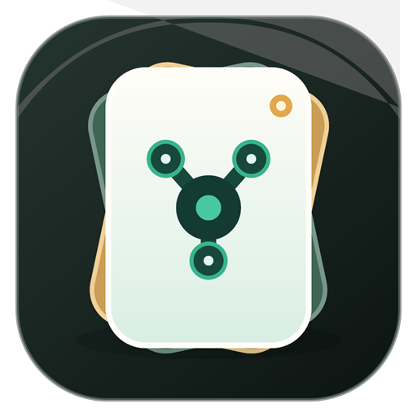
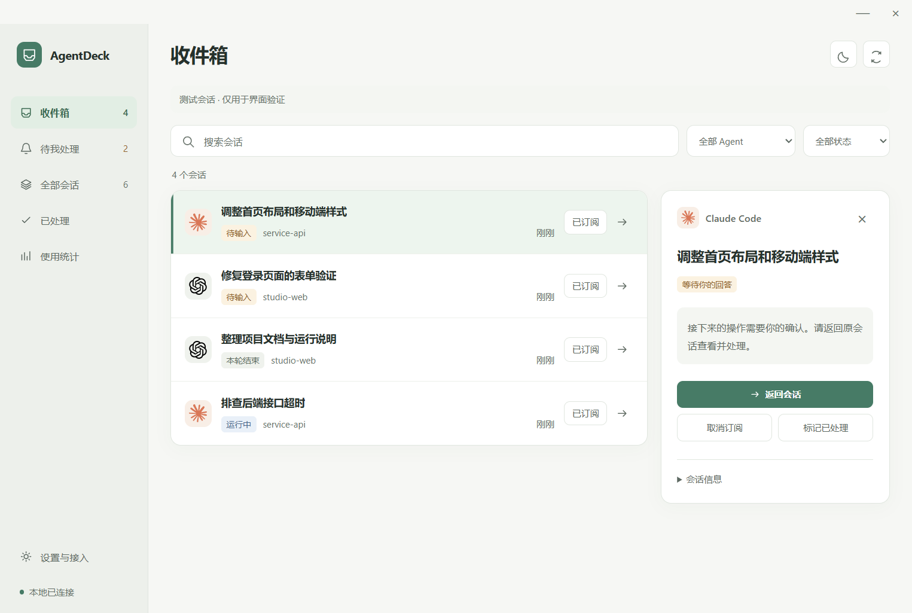

<p align="center">
  
</p>

<h1 align="center">AgentDeck</h1>

<p align="center">
  本地优先的 Windows 多 Agent 会话收件箱与使用统计工具
</p>

<p align="center">
  
  
  <a href="LICENSE"></a>
</p>

AgentDeck 把本机 Codex、Claude Code、Cursor、DeepSeek Harness 和 WorkBuddy 的会话集中到一个桌面工作台。它帮助你在多个 Agent 并行工作时找到需要处理的请求、订阅重要对话、回到原会话，并查看本机 Agent 活动时长。

截图数据为隔离测试会话，不包含用户真实对话。



## 能做什么

- **统一收件箱**：汇总本机多个 Agent 的历史会话与当前会话，支持搜索、来源筛选和状态筛选。
- **待处理提醒**：在 Agent 等待回答、授权、失败或额度异常时提醒；订阅和已处理状态保存在本机。
- **快速回到会话**：支持客户端深链接、终端恢复，以及在无法精确定位时唤起应用并复制会话 ID。
- **本地使用统计**：查看近 7 / 14 / 30 天活动趋势、活跃天数、单日最长时长和来源分布。
- **自定义 Agent**：配置本地文件或目录、JSONL 字段映射和回跳链接，让其他 Agent 也进入列表和统计。
- **Windows 桌面体验**：托盘、原生通知、全局快捷键、开机启动、深浅色主题和小窗口适配。
- **隐私优先**：默认只读本地数据，不上传会话，不内置云服务，也不需要账号或 API Key。

## 内置来源

| Agent | 会话发现 | 使用时长 | 数据方式 |
|---|---:|---:|---|
| Codex | 支持 | 支持 | 读取 `.codex` 本地 JSONL；实时通知可接入 Hook |
| Claude Code | 支持 | 支持 | 读取 `.claude` 本地 JSONL；实时通知可接入 Hook |
| Cursor | 支持 | 暂不精确统计 | 读取本地元数据与 JSONL；当前记录缺少逐条时间戳 |
| DeepSeek Harness | 支持 | 支持 | 自动只读 `.dsh` 会话与拼接 Zstandard 日志 |
| WorkBuddy | 支持 | 支持 | 自动读取 `.workbuddy` 数据库与项目 JSONL |

其他 Agent 可以通过“添加 Agent”接入。会话字段、状态、标题、工作目录、摘要和请求 ID 均可映射。

所有时间数据都来自对应客户端留下的本地记录。没有安装对应 Agent、客户端没有本地记录，或上游格式发生重大变化时，AgentDeck 无法凭空恢复数据。使用统计是 Agent 活动时间估算，不代表人在电脑前的挂机时长；并行 Agent 的合并时长会按时间线去重。

## 下载与使用

前往 **Releases** 下载 `AgentDeck-1.0.2-win-x64.zip`，完整解压后双击 `AgentDeck.exe`。请保留同目录中的 `resources` 和 DLL 文件。

当前程序没有商业代码签名，Windows SmartScreen 可能显示未知发布者。可以核对 Release 中提供的 SHA-256 后运行。

首次启动后：

1. 在“全部会话”查看本机 Agent 记录。
2. 打开“设置与接入”，按需接入 Codex、Claude Code 或 Cursor Hook。
3. 在“使用统计”查看活动趋势，或添加自定义 Agent。
4. 关闭主窗口会进入托盘；彻底退出请使用托盘菜单。

## 从源码运行

环境要求：Windows 10 / 11 x64、Node.js 24、npm。

```powershell
npm ci
npx install-electron
npm test
npm run typecheck
npm start
```

构建 Windows 应用目录：

```powershell
npm run dist
```

## 数据与隐私

应用数据保存在 `%APPDATA%\AgentInboxWindows`。客户端会话文件只读；完整正文不会上传，使用统计与自定义来源只提取配置中映射的元数据和时间戳。全文搜索默认关闭，开启后索引也只保存在本机。

提交 Issue 或日志前，请删除用户名、绝对路径、会话标题和其他敏感信息。

## Codex 共创说明

这个项目是一个人类主导、AI 深度参与的协作案例：

- 项目定位、产品取舍、功能验收、真实设备测试与公开发布由项目作者完成。
- OpenAI Codex 参与需求拆解、前后端实现、问题定位、自动化测试、打包发布和文档迭代。
- 所有外部操作和最终结果均经过实际运行、测试与人工检查。

## 上游与许可

AgentDeck 基于 [0xFANGO/agent-inbox](https://github.com/0xFANGO/agent-inbox) 的 `7ad035954e8cff1a16441ba0882496b7fb6961ed` 版本二次开发，与原作者无隶属或官方关联。

上游核心状态机、会话解析与部分标识素材继续保留原来源说明。项目整体使用 [MIT License](LICENSE)，详细第三方声明见 [THIRD-PARTY-NOTICES.txt](resources/THIRD-PARTY-NOTICES.txt)。

欢迎提交 Issue 和 Pull Request。问题描述、复现步骤和客户端版本越完整，越容易定位兼容性问题。
